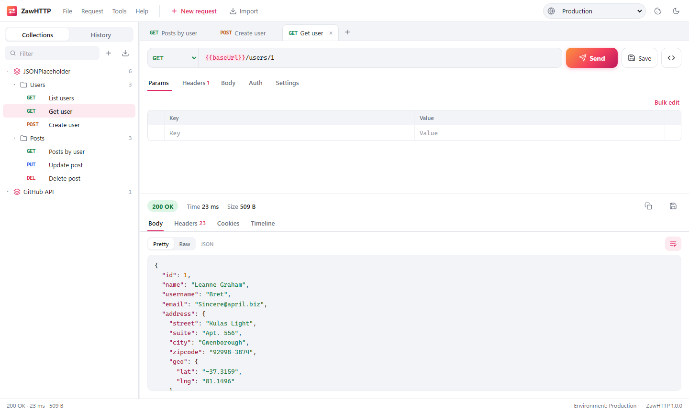

#  ZawHTTP

A lightweight HTTP client for testing APIs, in the spirit of Postman, written in C#. A sibling of ZawSQL, sharing its architecture and look.

<picture>
  <source media="(prefers-color-scheme: dark)" srcset="assets/screenshots/zawhttp-dark.png">
  
</picture>

The backend is an ASP.NET Core app that sends the requests (so there are no browser CORS limits, and it can read local files for uploads). The UI is plain HTML/CSS/JS embedded in the executable. ZawHTTP opens it in a chromeless **app-mode window** of an installed Chromium browser (Chrome, Edge, Chromium or Brave), so it looks and behaves like a desktop window on **Windows, Linux and macOS**. Closing the window quits the app.

## Features

- **Requests in tabs**: any method (GET, POST, PUT, PATCH, DELETE, HEAD, OPTIONS or a custom one), URL, query parameters, headers, body, auth and per-request settings. Open tabs, including unsaved edits, are restored on the next start.
  - **Params** and the URL stay in sync both ways. Unticked parameters are kept in the table but left out of the URL.
  - **Headers** with name suggestions. User-Agent, Accept, Content-Type (from the body) and Authorization (from the Auth tab) are added automatically unless you set them yourself.
  - **Body**: raw (JSON, text, XML, HTML, JavaScript, with *Beautify*), `x-www-form-urlencoded`, `multipart/form-data` (text fields and files) or a binary file. Files are given as local paths and read when the request is sent.
  - **Auth**: Basic, Bearer token, or API key (as a header or a query parameter).
  - **Settings**: timeout, follow redirects (and how many), SSL certificate verification.
  - Key/value tables have a **bulk edit** mode (`key: value` per line, `//` to disable a line).
- **Responses**: status, time, size, and:
  - **Body**: *Pretty* JSON with syntax highlighting. It is re-indented without being parsed, so large integers keep every digit. XML is indented, and there is *Raw*, word wrap and copy. HTML and SVG get a *Preview* in a sandboxed frame (no scripts). Images and PDFs are shown inline, and any response can be saved to a file.
  - **Headers**, **Cookies** (as set by the response) and a **Timeline**: the request exactly as sent (headers including cookies from the jar, body preview), every redirect hop, the response headers, and the time to first byte and download time.
  - Redirects are followed one hop at a time, the way browsers do it: 303, and 301/302 after a POST, continue as GET without the body. Credentials are dropped when a redirect leaves the host.
- **Collections**: collections and folders of saved requests in the sidebar, with drag and drop, rename, duplicate, delete, filter and export. Ctrl+S saves the tab back into its collection request. Tabs with unsaved changes are marked, and closing one asks first.
- **Environments and globals**: use `{{name}}` in the URL, params, headers, body and auth. The active environment overrides globals, values may refer to other variables, and there are dynamic variables `{{$guid}}`, `{{$timestamp}}`, `{{$isoTimestamp}}` and `{{$randomInt}}`. Hovering the URL shows it resolved, and variables left unresolved are flagged on the response.
- **History**: every request sent (up to 500), grouped by day, with status and time. It can be reopened, saved to a collection, copied as cURL or deleted.
- **Cookie jar**: cookies set by responses are kept and sent with later requests to the same site, the way a browser would. Tools › Cookies lists them, and you can delete them one by one or all at once.
- **Import** (Ctrl+O, or drop a file on the dialog):
  - **cURL**: bash syntax (including `$'…'`), and the Windows *Copy as cURL (cmd)* format from browser dev tools. Pasting a cURL command into the URL bar imports it straight into the tab.
  - **Postman collections** v2.0 / v2.1: folders, all body modes (GraphQL becomes a JSON body), auth including auth inherited from the collection or folder, and disabled headers and fields. Collection variables become an environment.
  - **Postman environments** and ZawHTTP's own exports.
- **Generate code**: the request as a cURL command, optionally with the variables filled in.
- **Light and dark themes** (or follow the system), a configurable editor font size, keyboard shortcuts.

### Keyboard shortcuts

| Keys | Action |
| --- | --- |
| Ctrl+Enter | Send the request (Enter in the URL bar too) |
| Esc | Cancel the running request |
| Ctrl+S / Ctrl+Shift+S | Save / Save as… |
| Ctrl+T / Ctrl+W | New tab / close tab |
| Ctrl+Tab / Ctrl+Shift+Tab | Next / previous tab |
| Ctrl+L | Go to the URL bar |
| Ctrl+O | Import |
| Ctrl+E | Environments |
| F2 | Rename the request |

## Where things are stored

Everything is kept in the configuration directory (`%APPDATA%\ZawHTTP` on Windows, `~/.config/ZawHTTP` on Linux and macOS, or `--config <dir>`):

| File | Contents |
| --- | --- |
| `collections.json` | Collections, folders and saved requests |
| `environments.json` | Globals and environments |
| `history.json` | The last 500 requests sent |
| `state.json` | Open tabs, preferences, layout |
| `browser/` | The app window's browser profile |

The files are plain JSON. Treat them like any file holding API tokens: environment values and auth fields are **not** encrypted.

## Security

- The backend listens on **127.0.0.1 only**, on a random port.
- Every API call must carry a random per-process token, which is passed to the window in the URL fragment. Other web pages and local programs can't use ZawHTTP to send requests.
- HTML previews run in a sandboxed frame with scripts disabled.

## Requirements

- To run a published build: nothing (self-contained), plus a Chromium-based browser for the app window. Without one the UI opens in the default browser.
- To build: the [.NET 10 SDK](https://dotnet.microsoft.com/download).

## Run from source

```sh
dotnet run --project src/ZawHTTP
```

On Windows, `run.bat` builds a Release build and starts it; any arguments are passed on (`run.bat --no-browser`).

Options (`ZawHTTP --help`): `--port <n>`, `--no-browser` (print the URL instead of opening a window), `--keep-alive`, `--browser <path>`, `--config <dir>`, `--token <value>`.

## Build standalone executables

```powershell
./publish.ps1                          # all platforms into dist/<rid>/
./publish.ps1 -Runtimes win-x64        # just Windows
```

```sh
./publish.sh linux-x64 osx-arm64
```

The result is a single self-contained file per platform (`ZawHTTP.exe` / `ZawHTTP`). Pushing a `vX.Y.Z` tag makes CI build all platforms and publish a GitHub release with `SHA256SUMS`.

### App icon

`assets/icon/zawhttp.svg` is the master drawing. `assets/icon/build-icons.ps1` draws the same icon with GDI+ and writes the PNGs, `src/ZawHTTP/zawhttp.ico` and `wwwroot/icon-256.png`:

```powershell
powershell -ExecutionPolicy Bypass -File assets/icon/build-icons.ps1
```

## Tests

```sh
dotnet test ZawHTTP.slnx
```

Unit tests cover variables, cURL import/export, Postman import and response handling. Integration tests start the real backend and send requests to a local echo server: redirects, cookies, timeouts, cancellation, multipart uploads, charsets, auth, history and the API token. No network access is needed.

## Project layout

```
src/ZawHTTP/
  Program.cs, AppHost.cs, AppOptions.cs   host, token check, command line
  BrowserLauncher.cs, Heartbeat.cs        app-mode window; quit when the last window closes
  Api.cs                                  /api endpoints
  HttpRunner.cs                           sending requests, redirects, cookie jar, response bodies
  Variables.cs                            {{variable}} resolution
  Curl.cs, Importer.cs                    cURL and Postman import / export
  Workspace.cs, Models.cs                 persistence and the request model
  wwwroot/                                the UI (embedded into the executable)
    js/app.js                             layout, menus, tabs, collections, persistence
    js/views/request.js                   request editor and response viewer
    js/views/sidebar.js                   collections tree and history
    js/views/tools.js                     dialogs: environments, import, code, cookies, preferences
tests/ZawHTTP.Tests/                      xUnit tests
```
